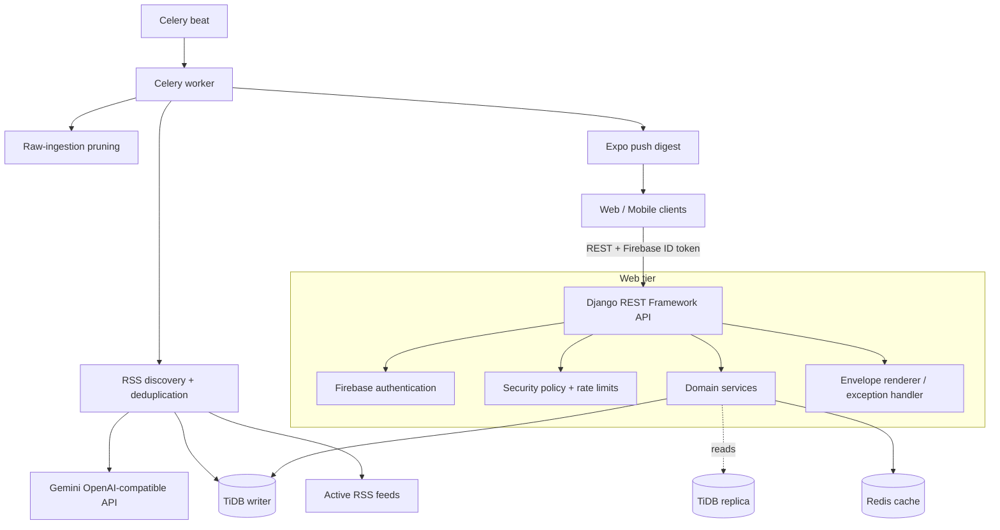

# Technical Architecture Document

This document describes the Django implementation of **TechPulse AI**, including its application boundaries, request lifecycle, asynchronous ingestion pipeline, and deployment topology.

---

## 1. System Architecture



The API remains stateless. Shared state lives in TiDB and Redis; scheduled work is executed by Celery workers and scheduled by Celery beat.

---

## 2. Django Application Layout

| App | Responsibility | Main models |
|---|---|---|
| `config` | Settings, URL routing, WSGI/ASGI, Celery configuration, TiDB URL parsing and replica routing. | - |
| `core` | API envelope, camelCase rendering, exception handling, Firebase authentication, correlation IDs, rate limits, health/deep-link endpoints, Gemini client. | - |
| `accounts` | User synchronisation, onboarding preferences, profile, login audit, push tokens. | `UserAccount`, `Category`, `UserPreference`, `UserProfile`, `UserInterest`, `UserFollow`, `LoginAudit` |
| `catalog` | Feed, trending feed, trends, search, event detail, related events, categories. | `TechnologyEvent`, `EventTimeline` |
| `library` | Bookmarks, reading history, collections, interaction tracking, library statistics. | `UserSavedEvent`, `UserCollection`, `CollectionEvent`, `InteractionLog`, `UserHistoryLog`, `RecommendationHistory`, `SearchHistory` |
| `assistant` | Stateless AI chat, feedback, regenerate/history compatibility responses. | - |
| `intelligence` | Public knowledge-graph/technology/company/release/timeline/compare reads and authenticated Gemini briefs. | - |
| `notifications` | Notification list, read state, preferences, and the Expo daily digest. | `NotificationRule`, `NotificationEvent` |
| `ingestion` | RSS collection, eligibility filtering, deduplication, quality ranking, Gemini synthesis, pruning, admin endpoints. | `RawIngestion`, `NewsSource` |

The Django models map directly to the existing TiDB tables through `Meta.db_table`. No client-facing schema rewrite is required.

---

## 3. Request Lifecycle

1. `CorrelationIdMiddleware` accepts `X-Correlation-ID` or generates a UUID and echoes it on the response.
2. CORS and Django security middleware process the request.
3. `FirebaseAuthenticationMiddleware` verifies the `Authorization: Bearer <Firebase ID token>` header once and caches the result on the request.
4. `RateLimitMiddleware` applies per-user/per-IP limits. AI endpoints use the configured AI limits and fail closed if Redis-based throttling is unavailable.
5. `SecurityPolicyMiddleware` mirrors the public, authenticated, and ADMIN path rules. Admin prefixes require an authenticated user with the `ADMIN` role.
6. DRF parses request bodies through `CamelCaseJSONParser`, which accepts camelCase keys and normalizes them to snake_case; existing clients may also send snake_case keys. Responses render through `ApiResponseJSONRenderer`.
7. Every response is wrapped as:

```json
{
  "success": true,
  "message": "OK",
  "data": {},
  "timestamp": 0,
  "traceId": "..."
}
```

`core.exceptions.api_exception_handler` applies the same envelope to authentication, permission, validation, and unexpected errors. The health and health-report endpoints intentionally bypass the envelope where the legacy contract requires raw JSON.

---

## 4. Asynchronous Processing

Three scheduled jobs run every day:

| Schedule | Task | Purpose |
|---|---|---|
| Every 8 hours at 00:00, 08:00, and 16:00 (`INGESTION_SCHEDULE_HOURS`) | `ingestion.tasks.scheduled_ingest` | Acquire a distributed cache lock and run the ingestion pipeline. |
| Daily at 00:00 | `ingestion.tasks.prune_raw_ingestions` | Delete stale processed/duplicate rows and leftover unprocessed rows. |
| Daily at 09:00 | `notifications.tasks.send_daily_cs_digest` | Send a random CS digest to registered Expo push tokens. |

The schedule is declared once in `backend/config/celery.py`, and `core.scheduler` runs the same three jobs from a daemon thread inside the web process, started on the first HTTP request (the Django equivalent of the Java backend's `@EnableScheduling`). The in-process scheduler is what runs on Render's free plan, where no worker or beat process exists. Set `INGESTION_SCHEDULER_ENABLED=false` when Celery Beat owns the schedule.

Ingestion uses the Java backend's fixed-clock semantics: it runs at minute 0 of hours divisible by `INGESTION_SCHEDULE_HOURS` (default 8), and the next run is always the next boundary regardless of how many articles the previous run saved. When the instance was asleep and a boundary passed, the scheduler catches up once on boot, then resumes the clock. A skipped run (another worker held the lock) and an exception are retried after 15 minutes instead of waiting for the next boundary. `GET /status` exposes the heartbeat, next boundary, last run, and recent request sightings for diagnosing missed runs.

Manual ingestion is available through the admin endpoint `POST /api/v1/admin/news/ingest`. By default it runs `ingest_all_feeds` in a background thread so the request returns below Gunicorn's timeout; `?async=true` enqueues it for a Celery worker, and `?sync=true` runs it inline. See [Pipeline.md](Pipeline.md) for the full data flow.

---

## 5. Data, Caching, and Scaling

- **Writer/replica routing**: `config.db.ReplicaRouter` sends reads to the `replica` database when `DATABASE_REPLICA_URL` is configured and all writes to `default`.
- **Feed pagination**: keyset pagination ordered by `fetched_at DESC, id DESC`; cursors are base64url-encoded `"<fetchedAt>\n<eventId>"` values with legacy event-ID fallback.
- **Caching**: `django-redis` caches feed pages, topic counts, trends, and the global event count. Cache failures fall back to database reads.
- **Rate limiting**: Redis counters when available; per-process in-memory buckets otherwise.
- **Ingestion concurrency**: `DISCOVERY_THREAD_POOL_SIZE` controls parallel RSS collection; `NEWS_MAX_ARTICLES_PER_INGESTION` caps synthesis per run.
- **Database indexes**: feed and deduplication queries rely on the existing `raw_ingestion` and `technology_event` indexes documented in [Database.md](Database.md).

---

## 6. Security Model

- Firebase ID tokens are verified with the Firebase Admin SDK. In tests only, `Bearer test:<uid>` is accepted when `ALLOW_TEST_AUTH` is enabled.
- Admin routes require the `ADMIN` database role; regular authenticated users receive `403`.
- Public routes cover the feed, trends, search, categories, event detail/related, and read-only intelligence endpoints. Assistant and brief generation require authentication.
- AI endpoints are rate-limited per user and per IP.
- CORS allows `WEB_APP_ORIGIN`, localhost origins, and `192.168.1.*` origins with the required headers.
- CSRF and clickjacking middleware are enabled; HTTPS proxy headers and secure cookies are configured for production.

---

## 7. Design Characteristics

- **Thin views, explicit services**: views handle HTTP validation and response envelopes; business logic lives in app-level service modules.
- **Contract-first compatibility**: camelCase JSON, envelope shape, datetime formatting, and feed cursor behaviour match the existing web/mobile clients.
- **Failure isolation**: per-source RSS failures, per-article synthesis failures, and cache/Redis failures do not stop the rest of a run.
- **Operational simplicity**: web, worker, and beat processes share one image and configuration; migrations and static collection are controlled by entrypoint flags.
