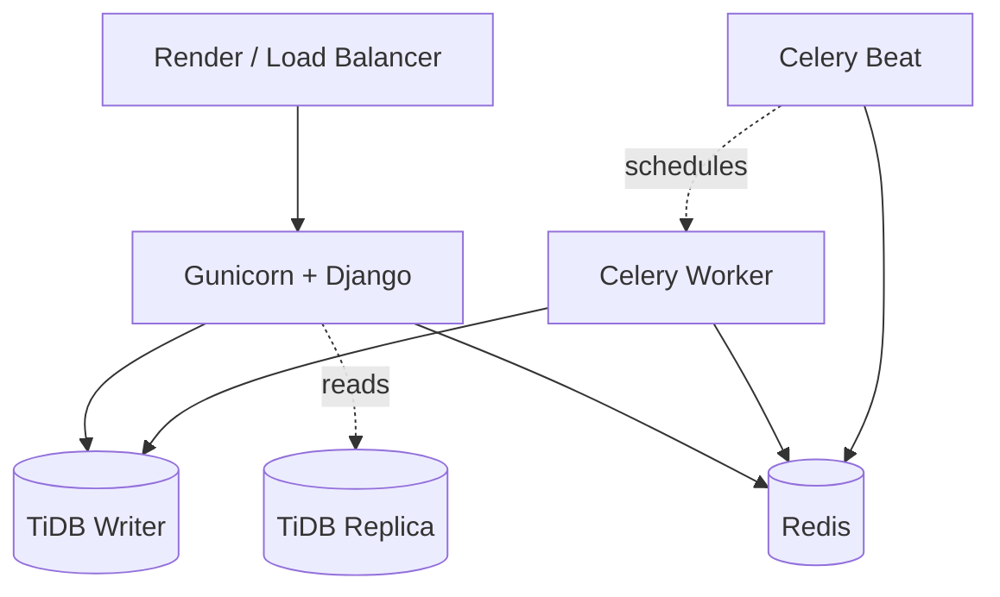

# Deployment Guide

This document details the configuration parameters, environment keys, and deployment requirements for the **TechPulse AI** Django backend.

---

## 1. Environment Configuration

Configuration is read from environment variables and, for local development, `backend/.env` via `python-dotenv`. Start from `backend/.env.example`.

| Environment Variable | Default | Description |
|---|---|---|
| `PORT` | `8080` | Gunicorn listen port. `/actuator/health` remains on this port. |
| `DJANGO_DEBUG` | `true` | Set to `false` in production. Enables secure cookies when false. |
| `DJANGO_SECRET_KEY` | dev secret | Django secret key. Use a long random value in production. `JWT_SECRET` is still accepted as a fallback name. |
| `ALLOWED_HOSTS` | `*` | Comma-separated host names accepted by Django. |
| `TZ` | `UTC` | Django time zone. The API still renders legacy local-datetime strings. |
| `WEB_APP_ORIGIN` | `https://techbite.onrender.com` | Additional allowed CORS origin. Localhost and `192.168.1.*` origins are always allowed. |
| `DATABASE_WRITER_URL` | - | TiDB writer URL. `mysql://` and legacy `jdbc:mysql://` URLs are accepted. |
| `DATABASE_WRITER_USER` | - | TiDB writer username. |
| `DATABASE_WRITER_PASSWORD` | - | TiDB writer password. |
| `DATABASE_REPLICA_URL` | writer URL | Optional TiDB replica URL. When set, the Django router sends reads to it. |
| `DATABASE_REPLICA_USER` | writer user | TiDB replica username. |
| `DATABASE_REPLICA_PASSWORD` | writer password | TiDB replica password. |
| `REDIS_URL` | `render.yaml`: `redis://red-d7tl3a1kh4rs73aruutg:6379` | Redis connection URL used for cache, Celery broker, and result backend. That value is Render's same-region internal URL (no password); use the external `rediss://` URL only when connecting from outside Render. |
| `REDIS_HOST` / `REDIS_PORT` | `localhost` / `6379` | Used to build `REDIS_URL` when it is not set. The Java-era `SPRING_DATA_REDIS_HOST` / `SPRING_DATA_REDIS_PORT` names are still honoured as fallbacks. |
| `CELERY_BROKER_URL` | `REDIS_URL` | Optional Celery broker override. |
| `CELERY_RESULT_BACKEND` | `REDIS_URL` | Optional Celery result backend override. |
| `CELERY_WORKER_CONCURRENCY` | `2` | Worker concurrency in Docker Compose. |
| `FIREBASE_CREDENTIALS_PATH` | - | Path to a Firebase service-account JSON file. |
| `FIREBASE_SERVICE_ACCOUNT_JSON` | - | Inline Firebase service-account JSON (preferred on Render). |
| `GEMINI_API_KEY` | - | Gemini API key used by ingestion and intelligence briefs. |
| `GEMINI_EXPLAIN_API_KEY` | `GEMINI_API_KEY` | Gemini key used by the assistant; falls back to the main key. |
| `GEMINI_BASE_URL` | Gemini OpenAI-compatible endpoint | Optional override for the Gemini API base URL. |
| `GEMINI_MODEL` | `gemini-3.5-flash-lite` | Primary Gemini model. |
| `GEMINI_FALLBACK_MODELS` | `gemini-3.8-flash,gemini-3.6-flash` | Comma-separated fallback model chain. |
| `NEWS_INGESTION_ENABLED` | `true` | Enables scheduled ingestion. |
| `INGESTION_SCHEDULER_ENABLED` | `true` | Runs the ingestion/pruning/digest jobs from a daemon thread inside the web process on the first request (the Django equivalent of the Java `@Scheduled` jobs). Set to `false` when Celery Beat owns the schedule, or in tests. |
| `INGESTION_SCHEDULE_HOURS` | `8` | Clock cadence for ingestion, equivalent to `@Scheduled(cron = "0 0 */N * * *")`: `8` runs at 00:00, 08:00, and 16:00 server time (UTC on Render), `4` restores the Java backend's original cadence. |
| `INGEST_TRIGGER_TOKEN` | generated by `render.yaml` | Shared secret for `GET /internal/ingest`, the external-scheduler hook that wakes a sleeping free instance and starts ingestion. Unset disables the route (it returns `404`). Copy the generated value into the cron service. |
| `SEED_REFERENCE_DATA` | `true` | Runs `python manage.py seed_reference_data` in the web entrypoint. It creates the 23 default news sources and 11 categories when they are missing and deactivates sources whose feed URL is not HTTP; without sources, discovery has nothing to read. |
| `NEWS_FRESHNESS_HOURS` | `24` | How old an article may be and still enter the pipeline. The Java port hard-coded 24; `render.yaml` sets 48 so feeds that publish a few times a week still qualify. |
| `NEWS_MAX_ARTICLES_PER_INGESTION` | `20` | Maximum articles synthesized per run. |
| `DISCOVERY_THREAD_POOL_SIZE` | `10` | Concurrent RSS collector threads. |
| `AI_RATE_LIMIT_PER_USER_PER_MINUTE` | `12` | Per-user limit for AI endpoints. |
| `AI_RATE_LIMIT_PER_IP_PER_MINUTE` | `30` | Per-IP limit for AI endpoints. |
| `ANDROID_SHA256_FINGERPRINT` | bundled default | SHA-256 fingerprint served by `/.well-known/assetlinks.json`. |
| `RUN_MIGRATIONS` | `true` | Runs `migrate --fake-initial` in the web entrypoint. Disable for workers. |
| `COLLECT_STATIC` | `true` | Runs `collectstatic` in the web entrypoint. Disable for workers. |
| `ALLOW_TEST_AUTH` | `false` | Accepts `Authorization: Bearer test:<uid>` for local contract testing only. |

The names above are a superset of the old Java backend's `.env`. `JWT_SECRET`, `SPRING_DATA_REDIS_HOST`, and `SPRING_DATA_REDIS_PORT` are still accepted as aliases, but `jwt.expiration`, `SPRING_PROFILES_ACTIVE`, and the Tomcat/pool tuning keys have no Django equivalent and can be dropped. `backend/.env` is git-ignored; start new environments from `backend/.env.example`.

**Django version pin:** `requirements.txt` keeps `Django>=6.0,<6.1`. Django 6.1 raised the minimum MySQL version to 8.4, while TiDB reports its compatibility version as 8.0.11 (TiDB's normal MySQL-compatible banner), so Django 6.1 refuses the connection with `MySQL 8.4 or later is required (found 8.0.11)`. Do not widen the pin until TiDB reports 8.4 or later.

**Celery/Kombu dependency:** `requirements.txt` lists `packaging` explicitly. Kombu's Redis transport imports it but only declares it under the `kombu[redis]` extra, so `celery` + `redis` alone left every `task.delay()` failing with `No module named 'packaging'`. Keep the dependency until Kombu declares it unconditionally.

Existing TiDB tables are reused through `Meta.db_table` and legacy column names. The first deploy uses `python manage.py migrate --fake-initial` so existing tables are marked as applied without being recreated. Django framework tables (`auth`, `admin`, `sessions`) are created on the same run. Celery Beat uses the file-based `PersistentScheduler`; the schedule itself is declared in `config/celery.py`, so no database-backed schedule tables are required.

Django 6.0 adds a foreign-key column and its constraint in one `ALTER TABLE` statement on MySQL. TiDB rejects that with `(1072, "Key column '..._id' doesn't exist in table")`, so `config.db.enable_tidb_schema_compatibility()` switches Django to the deferred constraint form. The patch is applied from `CoreConfig.ready()`, so every `manage.py` command gets it automatically.

---

## 2. Deployment Topology



- **Web**: Docker image from `backend/Dockerfile`, served by Gunicorn. The entrypoint runs migrations, seeds reference data, and collects static files before starting.
- **Worker**: `celery -A config worker`. Optional; handles RSS ingestion, synthesis, pruning, and the daily digest when the in-process scheduler is disabled.
- **Beat**: `celery -A config beat`. Optional alternative schedule: ingestion every 8 hours, pruning at midnight, and the daily push digest at 09:00.
- **In-process scheduler**: `core.scheduler` starts on the first HTTP request and runs the same three jobs from a daemon thread. This is what runs on Render's free plan, where no worker or beat process exists. Every Gunicorn worker starts the thread, but a `flock` on a temp file elects a single owner, so two workers cannot ingest the same article at once; if the owner exits, another takes over within a minute, and a request restarts a thread that died.
- **Ingestion clock**: like the Java backend's `@Scheduled(cron = "0 0 */4 * * *")`, ingestion runs at fixed clock boundaries — minute 0 of hours divisible by `INGESTION_SCHEDULE_HOURS` (default 8: 00:00, 08:00, 16:00 UTC). A productive run does not move the schedule. If the instance was asleep when a boundary passed, it runs once on boot to catch up, then returns to the clock.
- **Health**: `/actuator/health` returns a static `{"status": "UP"}` for liveness and is the path used by `render.yaml`. Render probes it with `HEAD`; the view answers `HEAD` without a body so Gunicorn does not log a no-body warning on every probe. The admin report at `/api/v1/admin/news/health` checks the database, round-trips a key through Redis (a write alone proves nothing because `django-redis` swallows connection errors), reports the last ingestion run from the `ingestion:lastRun` cache key (including whether it was triggered by `scheduler`, `manual`, `cron`, `cli`, or `celery`), reports the scheduler heartbeat from `scheduler:state`, and returns `503` when the database is down.
- **Diagnostics**: `GET /status` is public and read-only. It returns the scheduler heartbeat and next clock boundary, the last run, whether `INGEST_TRIGGER_TOKEN` is configured, the live commit, the event count, and the last 25 request sightings with their `User-Agent`. The sightings are written by middleware to Redis and are what distinguish "Render spun the service down" from "the uptime monitor is still probing".
- **Render free plan**: background workers require a paid instance type. The optional worker block in `render.yaml` is commented out; uncomment it (or run Celery elsewhere) to enable scheduled jobs.

### Keeping the free instance awake

The in-process scheduler lives inside the web container, so it only runs while Render keeps the instance up. A free web service is spun down after **15 minutes without inbound traffic**; when that happens the daemon thread dies with the container and nothing runs until the next request boots it again. On boot the scheduler compares the last completed run with the current clock boundary and catches up immediately if one passed while it was asleep (or if the last run failed or was skipped), so the feed stays within one cadence of fresh after a wake. Each tick also closes stale database connections; a thread that idled past TiDB's connection timeout otherwise fails its first run instantly with an empty driver error.

Manual runs do not move the clock: the next automatic run is still the next boundary, so triggering by hand cannot delay the schedule. Two cheap ways to keep automatic ingestion reliable:

1. **External pinger** (free): point an uptime monitor at `https://<service>.onrender.com/actuator/health` every 5 minutes. It must be the live service URL — a stale `*.onrender.com` host returns `404` and keeps nothing awake. Any inbound request also starts the scheduler thread.
2. **External cron** (recommended): call `GET /internal/ingest` every 4–8 hours with the shared token. It works without a Firebase session, boots a sleeping instance, and returns immediately while ingestion continues in a background thread:

```bash
curl -fsS -H "X-Ingest-Token: $INGEST_TRIGGER_TOKEN" \
  "https://<service>.onrender.com/internal/ingest"

# Blocking variant for a run that must finish before the caller exits.
curl -fsS -H "X-Ingest-Token: $INGEST_TRIGGER_TOKEN" \
  "https://<service>.onrender.com/internal/ingest?sync=true"
```

`/internal/ingest` is intentionally outside `/api/v1`, so it is not subject to the Firebase middleware or the rate limiter; the token is the only authentication and the route 404s when `INGEST_TRIGGER_TOKEN` is unset. Prefer the default background mode: a full run (RSS + Gemini) can exceed Render's proxy timeout when run synchronously.

### Verifying that automatic ingestion is really running

`GET /api/v1/admin/news/health` reports a `scheduler` component:

| Value | Meaning |
|---|---|
| `UP (started ..., elected=True, next run ..., heartbeat 12s ago)` | The thread is alive in a Gunicorn worker and the next run is scheduled. `heartbeat` older than three ticks (180s) means the instance is asleep or the thread died. |
| `DOWN (never started: no HTTP request has reached this instance yet)` | The container booted but has served no request, or the scheduler is disabled. |
| `DOWN (last heartbeat ...; the instance is asleep ...)` | The heartbeat is stale: Render spun the service down. Add a pinger or the external cron. |
| `DISABLED (INGESTION_SCHEDULER_ENABLED is false)` | Somebody turned the in-process scheduler off. |

`components.pipeline` shows the last run and its trigger, so `trigger scheduler` in the report proves an automatic run happened. On Render's free plan this state lives in Redis; if `redis` is `DOWN` every worker only sees its own memory and the scheduler component may read `DOWN`.

`GET /status` answers the same questions without a Firebase admin token, which is useful when the token is the thing that is unavailable:

```bash
curl -fsS https://techbite.onrender.com/status
```

- `scheduler.heartbeatAgeSeconds` older than ~180 means the instance is asleep or the thread died; `scheduler.nextIngestAt` is the next clock boundary.
- `scheduler.scheduleCron` shows the active cadence (`0 0 */8 * * *` by default).
- `lastRun.trigger` should read `scheduler` after an automatic run.
- `requests` lists the last probes with their `User-Agent`; if UptimeRobot is configured, its pings appear there. A gap in that list around a missed boundary is proof the instance was asleep.
- `ingestTriggerTokenConfigured` tells you whether `/internal/ingest` is enabled.
- `commit` is the deployed `RENDER_GIT_COMMIT`.


### Running ingestion without Celery

Rendering runs the jobs in-process by default, so a deployment ingests at 00:00, 08:00, and 16:00 UTC while the web service is awake. Redis is now configured, so the cache is shared across Gunicorn workers and the ingestion lock is real. The manual paths remain available:

```bash
# Synchronous run; use it as a Render cron job command or a one-off task.
python manage.py ingest_news [--max-articles 10] [--skip-if-disabled]

# Admin-only endpoint. Default: a daemon thread, so the request returns before
# Gunicorn's 120s timeout. ?sync=true blocks; ?async=true enqueues for Celery.
curl -X POST -H "Authorization: Bearer <firebase-id-token>" \
  "https://<service>.onrender.com/api/v1/admin/news/ingest"

# Diagnostics: per-feed eligibility counts, and the exact Gemini response.
python manage.py ingest_news --dry-run
python manage.py ingest_news --check-ai
```

`POST /api/v1/admin/news/ingest` has three modes:

| Request | Behaviour | Response `data` |
|---|---|---|
| no query parameter (default) | Runs in a daemon thread inside the web process and returns immediately. | `null` |
| `?sync=true` | Runs inline and blocks until the pipeline finishes. | `{"saved": N, "candidates": M}` |
| `?async=true` | Publishes a Celery task. Needs a running worker; without one it only queues. | `{"taskId": "...", "mode": "celery"}` |

The default used to call `.delay()` and fall back to an inline run when the broker was missing. Now that `REDIS_URL` exists, `.delay()` succeeds even when no worker is consuming the queue, so the old default returned success while doing nothing. The background thread is the safe default; `?async=true` is only for deployments that run a worker, and it returns `503` when the broker rejects the task.

`render.yaml` includes a commented `type: cron` service that runs `python manage.py ingest_news` every 8 hours as an optional paid safety net; Render bills cron jobs per second with a $1/month minimum per job. On the free plan, use the token-protected `/internal/ingest` hook described in "Keeping the free instance awake" instead — it costs nothing and needs no second service.

Ingestion locks are best-effort: when the cache backend is unreachable, `django-redis` returns `None` for `cache.add`, which used to be read as "another run is in progress" and silently skipped every run. `ingestion.tasks._acquire_lock` now fails open, so a missing Redis no longer blocks ingestion; with Redis configured, the lock prevents overlapping manual, scheduled, and background runs.

### Diagnosing a stalled feed

The pipeline can only stall in three places, and each is logged distinctly:

| Symptom in the logs | Meaning | Fix |
|---|---|---|
| `[DiscoveryAgent] Found 0 active sources` | `news_sources` is empty or every row has `active = false` | `python manage.py seed_reference_data` |
| `[RssCollector] ... rejected N entries outside the 24-hour/relevance rules` for every feed | Nothing is fresh enough or the entries are not developer news | Raise `NEWS_FRESHNESS_HOURS` |
| `[AI_SYNTHESIS] ... status=FAILED reason="400 from Gemini ..."` then `Successfully synthesized: 0/N` | Gemini rejected every article; the raw rows are deleted, so the feed does not change | `python manage.py ingest_news --check-ai` shows the provider's exact error. An invalid key returns `400 INVALID_ARGUMENT: Please pass a valid API key`. |

A run that finds candidates but saves none logs `[NewsIngestion] Discovered N article(s) but saved none`, so this failure is never silent. The in-process scheduler retries after 15 minutes when a run raises, after 1 hour when it saves nothing, and after 8 hours when it saves at least one event.

---

## 3. Deployment Checklist

1. Set all required environment variables in the hosting dashboard. Do not commit Firebase credentials or `.env` files.
2. Build from `backend/` with `docker build -t techpulse-backend .`.
3. Deploy the web service and confirm `/actuator/health` returns `UP`. The entrypoint seeds the 23 default news sources and 11 categories (`SEED_REFERENCE_DATA=true`), so check that the log line `News sources: created 0, total 23, active 23` appears on later deploys.
4. Verify the pipeline end to end: `python manage.py ingest_news --check-ai` (Gemini credentials), then `python manage.py ingest_news --max-articles 1` (one real event).
5. Start worker and beat processes with the same database, Redis, Firebase, and Gemini configuration. Set `RUN_MIGRATIONS=false` and `COLLECT_STATIC=false` for both.
6. Run `python manage.py check --deploy` and enable HSTS / SSL redirect at the proxy or in settings once the domain is HTTPS-only.
