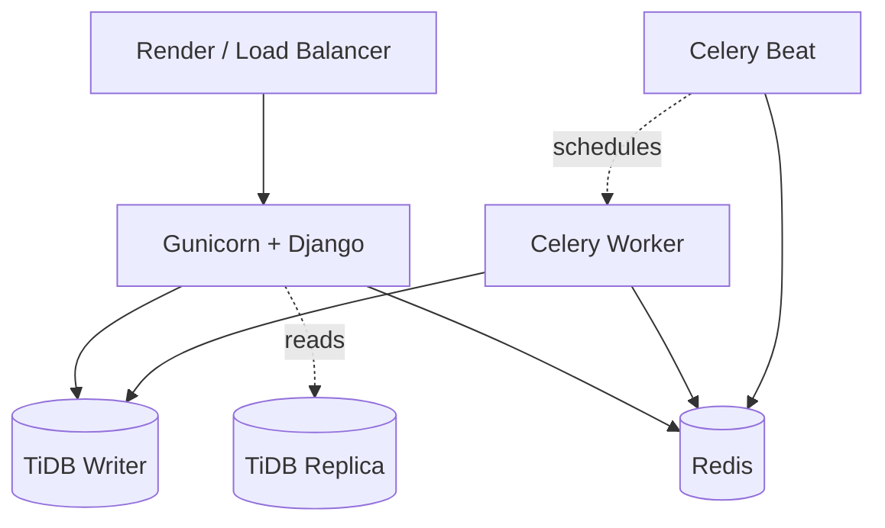

# Deployment Guide

This document details the configuration parameters, environment keys, and deployment requirements for the **TechPulse AI** Django backend.

---

## 1. Environment Configuration

Configuration is read from environment variables and, for local development, `backend/.env` via `python-dotenv`. Start from `backend/.env.example`.

| Environment Variable | Default | Description |
|---|---|---|
| `PORT` | `8080` | Gunicorn listen port. `/actuator/health` remains on this port. |
| `DJANGO_DEBUG` | `true` | Set to `false` in production. Enables secure cookies when false. |
| `DJANGO_SECRET_KEY` | dev secret | Django secret key. Use a long random value in production. |
| `ALLOWED_HOSTS` | `*` | Comma-separated host names accepted by Django. |
| `WEB_APP_ORIGIN` | `https://techpulse.onrender.com` | Additional allowed CORS origin. Localhost and `192.168.1.*` origins are always allowed. |
| `DATABASE_WRITER_URL` | - | TiDB writer URL. `mysql://` and legacy `jdbc:mysql://` URLs are accepted. |
| `DATABASE_WRITER_USER` | - | TiDB writer username. |
| `DATABASE_WRITER_PASSWORD` | - | TiDB writer password. |
| `DATABASE_REPLICA_URL` | writer URL | Optional TiDB replica URL. When set, the Django router sends reads to it. |
| `DATABASE_REPLICA_USER` | writer user | TiDB replica username. |
| `DATABASE_REPLICA_PASSWORD` | writer password | TiDB replica password. |
| `REDIS_URL` | derived from `REDIS_HOST`/`REDIS_PORT` | Redis connection URL used for cache, Celery broker, and result backend. |
| `REDIS_HOST` / `REDIS_PORT` | `localhost` / `6379` | Used to build `REDIS_URL` when it is not set. |
| `CELERY_BROKER_URL` | `REDIS_URL` | Optional Celery broker override. |
| `CELERY_RESULT_BACKEND` | `REDIS_URL` | Optional Celery result backend override. |
| `CELERY_WORKER_CONCURRENCY` | `2` | Worker concurrency in Docker Compose. |
| `FIREBASE_CREDENTIALS_PATH` | - | Path to a Firebase service-account JSON file. |
| `FIREBASE_SERVICE_ACCOUNT_JSON` | - | Inline Firebase service-account JSON (preferred on Render). |
| `GEMINI_API_KEY` | - | Gemini API key used by ingestion and intelligence briefs. |
| `GEMINI_EXPLAIN_API_KEY` | `GEMINI_API_KEY` | Gemini key used by the assistant; falls back to the main key. |
| `GEMINI_MODEL` | `gemini-3.5-flash-lite` | Primary Gemini model. |
| `GEMINI_FALLBACK_MODELS` | `gemini-3.8-flash,gemini-3.6-flash` | Comma-separated fallback model chain. |
| `NEWS_INGESTION_ENABLED` | `true` | Enables scheduled ingestion. |
| `NEWS_MAX_ARTICLES_PER_INGESTION` | `20` | Maximum articles synthesized per run. |
| `DISCOVERY_THREAD_POOL_SIZE` | `10` | Concurrent RSS collector threads. |
| `AI_RATE_LIMIT_PER_USER_PER_MINUTE` | `12` | Per-user limit for AI endpoints. |
| `AI_RATE_LIMIT_PER_IP_PER_MINUTE` | `30` | Per-IP limit for AI endpoints. |
| `ANDROID_SHA256_FINGERPRINT` | bundled default | SHA-256 fingerprint served by `/.well-known/assetlinks.json`. |
| `RUN_MIGRATIONS` | `true` | Runs `migrate --fake-initial` in the web entrypoint. Disable for workers. |
| `COLLECT_STATIC` | `true` | Runs `collectstatic` in the web entrypoint. Disable for workers. |

Existing TiDB tables are reused through `Meta.db_table` and legacy column names. The first deploy uses `python manage.py migrate --fake-initial` so existing tables are marked as applied without being recreated. `django_celery_beat` tables are created on the same run.

---

## 2. Deployment Topology

- **Web**: Docker image from `backend/Dockerfile`, served by Gunicorn. The entrypoint runs migrations and static collection before starting.
- **Worker**: `celery -A config worker`. Handles RSS ingestion, synthesis, pruning, and the daily digest.
- **Beat**: `celery -A config beat`. Schedules ingestion every 8 hours, pruning at midnight, and the daily push digest at 09:00.
- **Health**: `/actuator/health` returns a static `{"status": "UP"}` for liveness and is the path used by `render.yaml`. The admin report at `/api/v1/admin/news/health` checks the database and returns `503` when it is down.
- **Render free plan**: background workers require a paid instance type. The optional worker block in `render.yaml` is commented out; uncomment it (or run Celery elsewhere) to enable scheduled jobs.

---

## 3. Deployment Checklist

1. Set all required environment variables in the hosting dashboard. Do not commit Firebase credentials or `.env` files.
2. Build from `backend/` with `docker build -t techpulse-backend .`.
3. Deploy the web service and confirm `/actuator/health` returns `UP`.
4. Start worker and beat processes with the same database, Redis, Firebase, and Gemini configuration. Set `RUN_MIGRATIONS=false` and `COLLECT_STATIC=false` for both.
5. Run `python manage.py check --deploy` and enable HSTS / SSL redirect at the proxy or in settings once the domain is HTTPS-only.
