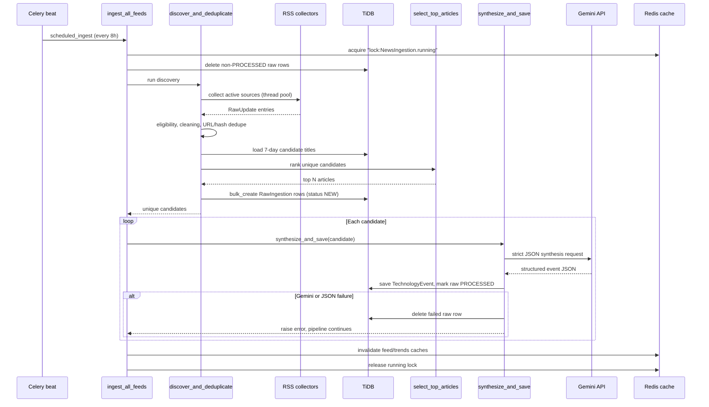

# Pipeline Processing and Data Flows

This document describes the Django ingestion pipeline: how RSS updates move from collection to deduplication, quality ranking, Gemini synthesis, and persistence.

---

## 1. End-to-End Flow

A separate beat task, `prune_raw_ingestions`, runs at midnight.

---

## 2. Data Structures

### `RawUpdate`

`ingestion.agents.rss.RawUpdate` is an in-memory dataclass produced by the RSS collector:

| Field | Description |
|---|---|
| `title`, `raw_content` | Feed entry title and cleaned text. |
| `source_url`, `canonical_url` | Original link and canonical link supplied by the collector. |
| `published_at`, `fetched_at` | Publication time and collection time. |
| `source_name`, `source_type` | Configured source name and `RSS`. |
| `author`, `language` | Optional entry author and feed language. |

### `RawIngestion`

The `ingestion.RawIngestion` model maps to the existing `raw_ingestion` table. Important fields:

- `id`, `run_id`, `event_id` — UUIDs for the row, discovery run, and event group.
- `title`, `raw_content`, `url`, `canonical_url` — cleaned content and normalized URLs.
- `url_hash`, `title_hash` — SHA-256 values used for exact deduplication.
- `processing_status` — `NEW` when created, `PROCESSED` after successful synthesis.
- Credibility/importance and event-lifecycle columns — retained for schema compatibility; synthesis fills the scores that the current API exposes.

Duplicates are discarded rather than inserted. A new unique candidate receives a fresh `event_id`; the same ID is used when the `TechnologyEvent` row is created.

### `TechnologyEvent`

The `catalog.TechnologyEvent` model maps to `technology_event` and is the read model for the API. Synthesis writes the headline, summary, category, topics, impacts, version/lifecycle fields, official links, source scores, and Gemini token/latency metadata.

There is no separate DTO layer. Internal code uses dataclasses and Django models; the API boundary converts snake_case request fields and renders camelCase response fields.

---

## 3. Discovery Phase

1. Load active `NewsSource` rows.
2. Collect each feed concurrently with `ThreadPoolExecutor(max_workers=DISCOVERY_THREAD_POOL_SIZE)`.
3. For each entry, require a publication date within the last 24 hours and a software-engineering or .NET signal.
4. Clean HTML with BeautifulSoup, normalize URLs, and compute URL/title SHA-256 hashes.
5. Discard exact duplicates within the current batch or in the database.
6. Compare remaining candidates against the last 7 days of raw rows: require publication times within 48 hours and token overlap, then apply Jaro-Winkler similarity ≥ `0.85`.
7. Rank unique candidates with the editorial quality score and select at most `NEWS_MAX_ARTICLES_PER_INGESTION` articles.
8. Insert selected candidates with `bulk_create` inside `transaction.atomic()`.

The detailed scoring and similarity rules are documented in [Agents.md](Agents.md).

---

## 4. Synthesis Phase

`synthesize_and_save` builds a prompt from the raw title and first 3,500 characters of content. The prompt:

- selects exactly one category from the known taxonomy;
- extracts 3–5 topics;
- requests importance and credibility scores from 0–100;
- extracts version, lifecycle status, impacts, migration notes, breaking changes, security notes, and official links;
- enforces specific headline rules.

Gemini is called with `temperature=0.2`, `max_tokens=2048`, and a strict-JSON system prompt. The response is parsed as JSON, falling back to `Emerging Tech` for an unknown category and the raw title when the generated title is empty. A successful synthesis writes one `TechnologyEvent`, marks the raw row `PROCESSED`, and records model/token/latency metadata.

On Gemini failure or malformed JSON, the raw row is deleted immediately and the exception is re-raised so the task can continue with the next candidate.

---

## 5. Failure and Locking Behaviour

| Situation | Behaviour |
|---|---|
| Scheduled run starts while another run holds the lock | Skipped with `{"skipped": true}`. |
| Ingestion already running | `ingest_all_feeds` skips and releases its lock. |
| Old unprocessed/failed raw rows exist | Deleted before discovery. |
| One RSS feed fails | Logged; other feeds continue. |
| One synthesis fails | Raw row deleted; remaining candidates continue. |
| Cache invalidation fails | Logged/swallowed; database remains authoritative. |
| Worker crashes mid-run | The cache lock expires after its timeout, allowing a later run. |

Locks use `cache.add` with 15 minutes for the scheduled wrapper and 60 minutes for the ingestion run. Cache invalidation removes `feed-v3:*`, `trends:*`, `trends:topic-counts-v1`, `trends:admin-v1`, and `totalBiteCount:global`.

---

## 6. Pruning

`prune_raw_ingestions`:

- deletes `PROCESSED` and `DUPLICATE` rows older than 14 days;
- deletes every remaining non-`PROCESSED` row;
- returns counts for processed and unprocessed deletions.

This keeps the raw staging table compact while preserving the synthesized `technology_event` read model.

---

## 7. Scheduling Summary

| Task | Schedule | Entry point |
|---|---|---|
| News ingestion | Every 8 hours (`minute=0, hour="*/8"`) | `ingestion.tasks.scheduled_ingest` |
| Raw-ingestion pruning | Daily at midnight | `ingestion.tasks.prune_raw_ingestions` |
| CS push digest | Daily at 09:00 | `notifications.tasks.send_daily_cs_digest` |

The schedule is defined in `backend/config/celery.py`.
